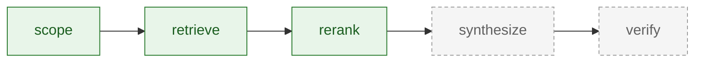

# Gatekeeper

Status: weekend-1 vertical, pre-milestone — synthesis and the verify gate are not built.

Gatekeeper takes a Next.js question, classifies it, retrieves 30 chunks, and lets a policy decide which chunks survive. Two decision-model gates are built — scope and rerank — and one more is planned, each running before any text is written. Every built stage reports its scores in the response trace. The corpus, the policy objects and the prices are committed, and the test suite runs offline against fixtures.



Solid green is built. Dashed grey is planned.

## Run

```bash
uv sync
uv run pytest -q
uv run python -m scripts.trace "how do I read a route param in the app router" --policy strict
uv run uvicorn app.main:app --reload
curl -s localhost:8000/health
```

The test suite runs offline against committed fixtures. The `trace` and `uvicorn` commands call the live models and need `GEMINI_API_KEY` in the environment.

## Corpus

`vercel/next.js` at `8d1f4ed9c010`, MIT, 17 files, 246 chunks, 21 legacy, 17 synthetic forum.

Corpus provenance and the source of the labels are in `../../research/Optimizing RAG With Jev Reranking/brief.md`.
